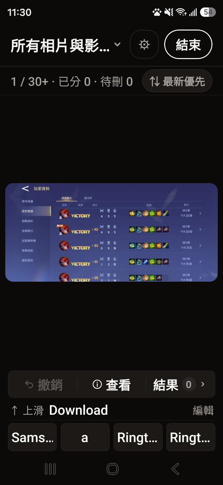
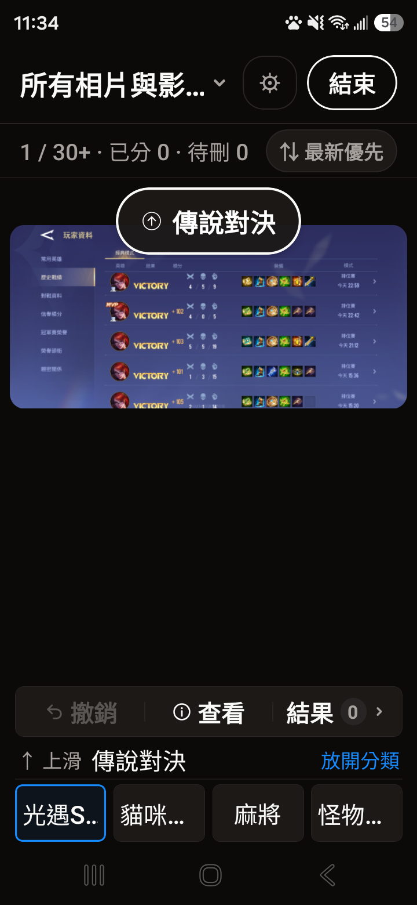

# 揀影 PicSorter

用滑動手勢整理手機裡的照片與影片，先分類、再檢查，最後一次套用到系統相簿。整理紀錄保存在手機，不需要登入，也不會上傳照片。

[下載 Android APK](https://github.com/jimmy-shian/PicSorter/releases) · [建置與發布說明](docs/RELEASING.md)

## 可以做什麼？

- **整理照片與影片**：選擇所有媒體或單一來源相簿，依最新或最舊順序逐張整理。
- **滑動分類**：預設向上放入上滑目標相簿、向下放入下滑目標相簿、向左略過、向右標記待刪除。四個方向皆可自訂，也能關閉。
- **快速選擇目標**：設定最多 4 個快捷相簿，點選或長按照片後拖曳到相簿分類。
- **管理相簿**：搜尋名稱、建立相簿、固定常用相簿、拖曳排序及隱藏。隱藏相簿集中在管理頁底部，恢復顯示後回到保留的排序位置。這些顯示設定只影響 PicSorter。
- **檢查再套用**：撤銷分類、查看照片資訊、檢查結果或改放其他相簿。標記待刪除時不會立即刪除照片。
- **繼續未完成的整理**：本機 SQLite 保存進度，可從設定頁繼續或捨棄。
- **個人化設定**：深色／淺色／跟隨系統、照片排序、相簿移動確認及垃圾桶確認。

## 畫面預覽

以下為現有 Android 版本的實機截圖，展示分類與拖曳操作；搜尋與管理介面的調整以最新版本為準。

<table>
  <tr>
    <td></td>
    <td></td>
  </tr>
  <tr><td>照片與影片分類</td><td>拖曳到目標相簿</td></tr>
</table>

## 使用方式

1. 授予照片與影片存取權限，選擇要整理的來源相簿。
2. 從「設定 → 分類相簿」或主畫面的目標相簿列，設定上下滑目標及快捷。可搜尋相簿名稱；進入「管理相簿」調整排序、固定與隱藏。
3. 滑動、點選快捷，或長按照片後拖曳到相簿。需要修正時使用「撤銷」或進入「結果」。
4. 確認分類與待刪項目，再套用變更。系統要求移動或刪除授權時依畫面確認。

手勢設定中的 `↑ ⇄ ←` 表示選取後，上滑與左滑交換動作。「無動作」可同時指定給多個方向。

Android 11 以上使用系統垃圾桶；Android 10 以下若需永久刪除，App 會另外確認。iOS 使用系統照片權限與刪除機制。Android 為目前 APK 發布目標，iOS 程式碼仍需另外建置與實機驗證。

## 專案內容

使用 Expo SDK 57、React Native 0.86、React 19 與 TypeScript。Expo Router 負責畫面切換，expo-media-library 存取媒體，expo-sqlite 保存分類決定與偏好，expo-image／expo-video 顯示照片與影片。

```text
src/app/                 分類主畫面、設定、結果檢查與套用頁
src/components/          相簿搜尋與管理、分類手勢、媒體預覽、確認對話框
src/lib/                 媒體存取、SQLite、分類進度、相簿排序與套用流程
modules/pic-sorter-trash/ Android／iOS 系統垃圾桶原生模組
assets/                  App 圖示與啟動畫面素材
tests/                   分類設定、拖曳排序、垃圾桶與套用流程測試
.github/workflows/       自動檢查、Gradle 建置及 GitHub Release 發布
```

`android/` 與 `ios/` 是 Expo 產生的原生專案，不納入版本控制；原生設定集中在 `app.config.js` 與本地模組。版本號以 `package.json` 為唯一來源，Android versionCode 及 iOS buildNumber 由設定檔推導。

## 開發

使用 Node.js 24 與 npm。安裝依賴後啟動開發伺服器：

```sh
npm ci
npx expo start --dev-client
```

專案包含自訂垃圾桶原生模組，需要 development build；Expo Go 無法完整執行所有功能。Android 本機開發可使用 `npm run android`。新增 Expo／React Native 依賴時，使用 `npx expo install <package>` 選擇相容版本。

提交前檢查：

```sh
npm run lint
npm run typecheck
node --test tests/*.test.cjs
```

## APK 發布

GitHub Actions 在 pull request 執行檢查；推送與 `package.json` 一致的 `v*` tag，或手動執行 master 的 workflow，會直接在 GitHub runner 使用 Android SDK 與 Gradle 編譯 universal release APK，沿用既有簽章並驗證後，上傳 GitHub Release 與 SHA-256 校驗碼。

CI 的簽章保存在 GitHub Secrets，完整操作見 [RELEASING.md](docs/RELEASING.md)。

## 授權

採用 [MIT License](LICENSE)。
